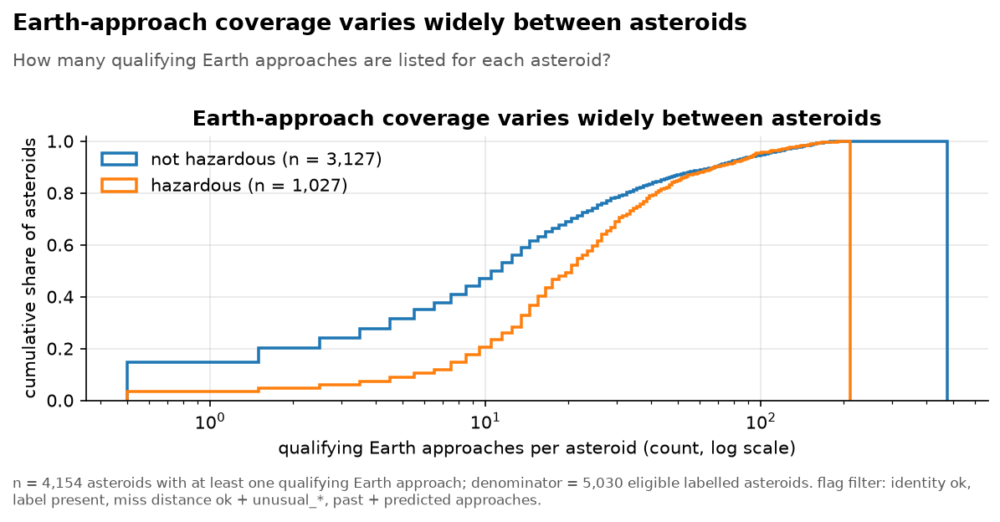
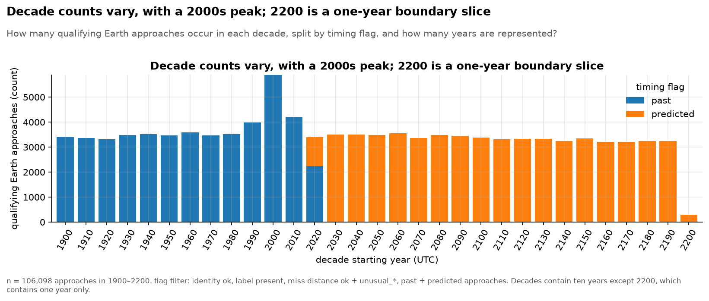
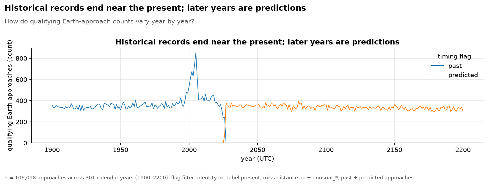
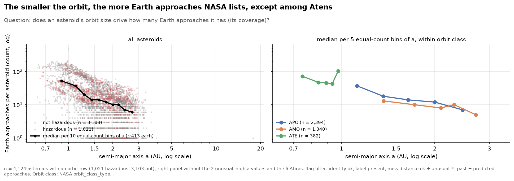
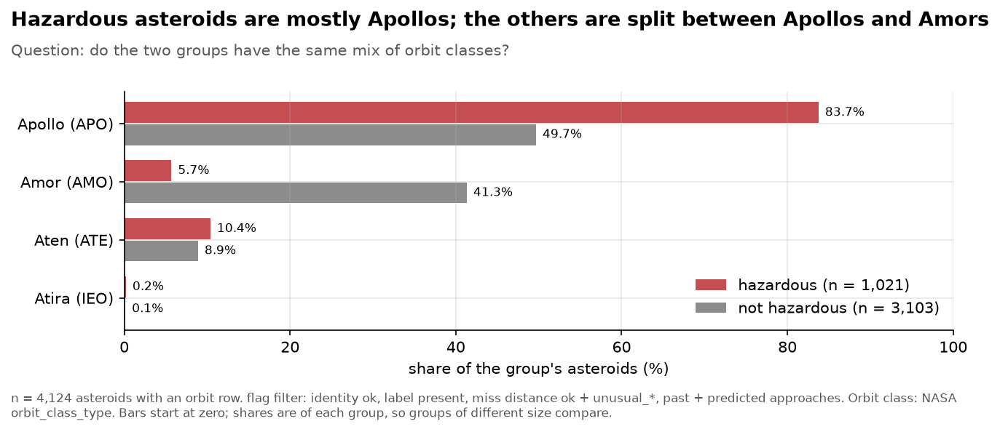
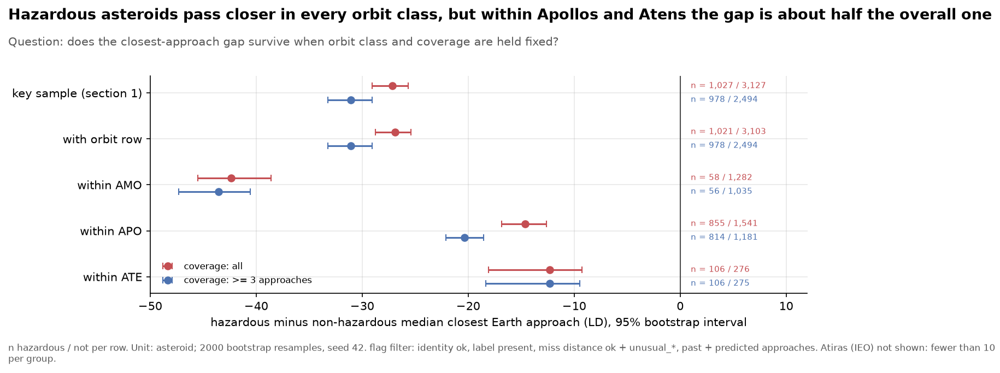

# Exploratory Analysis — NASA Near-Earth Asteroid Hazard Analysis

**Milestone:** M4 (EXPLORE) · **Team:** Burak Avşar · Rana Yalçın · Elif Şahin
**Data:** the cleaned layer built from 360 raw NeoWs files retrieved on 2026-10-17 (5,033 asteroids, 5,000 orbits, 150,936 close approaches).
**Notebook:** [`notebooks/m4_eda.ipynb`](../notebooks/m4_eda.ipynb), which reads `data/asteroids.db` read-only and checks the file's SHA-256 is unchanged at the end.
Reused queries are in [`sql/queries/`](../sql/queries/).

**Flag filter used throughout (`KEY_FILTER`)** unless a table says otherwise: identity `ok` (the 3 duplicate NASA ids counted once), hazard label present
(the 15 `label_rule_mismatch` asteroids kept), miss distance `ok` + `unusual_*`, past + predicted approaches. One lunar distance (LD) = 384,400 km;
NASA's hazard limit 0.05 AU = 19.5 LD.

| Section | Explored by |
|---|---|
| 2–4 Raw vs cleaned, question and summary, shape | Burak Avşar |
| 4 Coverage and flag filter, 5 Time | Rana Yalçın |
| 6 Relationships, 7 Comparison | Elif Şahin |

---

## 1. Summary

Our question is which asteroid features go with NASA's "potentially hazardous" label. M4 looks at it through one number: **how close each asteroid
comes to Earth**. Hazardous asteroids' median closest approach is **13.1 LD**, against **40.2 LD** for the others (n = 1,027 vs 3,127), a gap of
**−27.1 LD (95% bootstrap CI −29.1 to −25.7)**. Three things limit how far that number goes. **Part of it is by construction**, because the label
requires MOID ≤ 0.05 AU. **Part of it is composition**: the groups have very different orbit-class mixes, and within Apollos and Atens the gap is
about half as large (−14.6 and −12.3 LD). And **the summary decides the ranking**: the share of asteroids that ever pass closer than the Moon is
the same in both groups (~1.2%), because the label is about size as much as orbit. All findings are exploratory and come from one retrieval day
and NASA's browse order, not a random sample. The main thing that could change them is a coverage definition from NASA: the listed approaches
stop at one of two undocumented cut-offs (0.2 or 0.5 AU).

**M3 issues fixed since the M3 tag:** none needed. Cleaning did not change the key number (section 2). Exploration added three entries to the
M3 issues register (I-13 to I-15, section 8).

---

## 2. Raw versus cleaned

The key number is the **median closest Earth approach per asteroid, by hazard label**. It is computed on the M2 tables as loaded and on the
cleaned layer with `KEY_FILTER`.

```sql
-- sql/queries/closest_earth_raw.sql (M2 tables; no flags exist)
SELECT a.asteroid_key, a.is_potentially_hazardous AS hazardous,
       MIN(p.miss_distance_km) AS closest_km, COUNT(*) AS n_earth_approaches
FROM asteroids AS a
JOIN approaches AS p ON p.asteroid_key = a.asteroid_key
WHERE p.orbiting_body = 'Earth'
GROUP BY a.asteroid_key, a.is_potentially_hazardous;

-- sql/queries/closest_earth_clean.sql (cleaned layer; filter passed as parameters)
SELECT c.asteroid_key, c.is_potentially_hazardous AS hazardous,
       MIN(p.miss_distance_km) AS closest_km, COUNT(*) AS n_earth_approaches
FROM asteroid_clean AS c
JOIN approach_clean AS p ON p.asteroid_key = c.asteroid_key
WHERE p.orbiting_body = 'Earth'
  AND c.identity_flag = 'ok'
  AND c.is_potentially_hazardous IS NOT NULL
  AND (c.is_potentially_hazardous_flag <> 'label_rule_mismatch' OR :exclude_label_mismatch = 0)
  AND p.miss_distance_km IS NOT NULL
  AND (p.miss_distance_km_flag = 'ok' OR :include_unusual = 1)
  AND (p.timing_flag = 'past' OR :include_predicted = 1)
GROUP BY c.asteroid_key, c.is_potentially_hazardous;
```

| Group | Raw: n | Raw: median (LD) | Cleaned: n | Cleaned: median (LD) |
|---|---:|---:|---:|---:|
| not hazardous | 3,127 | 40.22 | 3,127 | 40.22 |
| hazardous | 1,030 | 13.08 | 1,027 | 13.07 |

Cleaning changes the inputs but not the answer. The cleaned version counts the **3 duplicate NASA ids** once (M3 issue I-08). Their approaches
are the same events as those of the numbered asteroid, so the raw table counted three hazardous asteroids twice. No asteroid's closest distance
changes: M3 found no invalid miss distance, and the filter keeps the `unusual_*` values. Our cleaning was about coverage and identity, not bad
numbers, so this is a result, not a non-event.

---

## 3. The question and its summary

**Question:** *How much closer to Earth do potentially hazardous asteroids typically come than non-hazardous ones?*

**Summary: the median** of each asteroid's closest approach. The question asks about the *typical* asteroid. The distances are right-skewed
(section 4), so a long tail of distant passes pulls the mean up. And each asteroid counts once, whatever its number of approaches.

| Group | n | Median (LD) | Mean (LD) | 10th pct (LD) | Share closer than the Moon | Share within 0.05 AU |
|---|---:|---:|---:|---:|---:|---:|
| not hazardous | 3,127 | 40.22 | 46.74 | 6.28 | 1.28% (40) | 25.3% |
| hazardous | 1,027 | 13.07 | 16.16 | 4.28 | 1.17% (12) | 74.6% |

**The alternative summary ranks the groups differently.** By the median, the mean and the 10th percentile, hazardous asteroids come about three
times closer. By the **share that ever passes closer than the Moon**, the groups are level. The two answer different questions: *how close does a
typical member come* versus *how often does a really close pass happen*. The 40 non-hazardous asteroids that pass inside 1 LD are **small**
(median H 26.9, 39 of 40 above H = 22), so they fail the size half of NASA's definition however close they come.

---

## 4. What the data is made of

### Shape


We tried bin widths of 1, 5 and 10 LD. **5 LD** is the coarsest width that keeps the three features every panel shows:
- a peak at 5–10 LD;
- a drop just after 19.5 LD (the 0.05 AU limit);
- a step at ~78 LD.


Both groups are **right-skewed** (skew 1.12 not hazardous, 2.60 hazardous), with no second mode. Three quarters of hazardous asteroids pass within
0.05 AU, and their histogram falls steeply after it. That is partly by construction, because the label needs a MOID within 0.05 AU. The
non-hazardous group is flat and wide, out to 193 LD. On the log-scale ECDF the curves meet **below 1 LD**, which is the tie in section 3. With this
much skew the mean overstates the typical distance (mean > median in both groups), so the median is the right summary.

**The step at ~78 LD is a listing limit, not nature.** The farthest listed Earth approach of each asteroid piles up just below **0.2 AU**
(1,594 asteroids) and just below **0.5 AU** (1,838), with few in between. NASA lists approaches to one of two cut-offs, and the cause is
undocumented. Within each listing limit, the hazardous median is still about a third of the non-hazardous one:

| Listing limit | n not / hazardous | Median not (LD) | Median hazardous (LD) |
|---|---:|---:|---:|
| listed to 0.2 AU | 1,418 / 654 | 38.48 | 12.86 |
| listed to 0.5 AU | 1,709 / 373 | 44.65 | 13.69 |

### Coverage table and coverage rule

The unit is the asteroid. The denominator is the 5,030 cleaned asteroids with a resolved identity and a hazard label. Of those, 4,154 have at
least one qualifying Earth approach. NASA's feed is not a census of possible encounters (the cut-offs above), so "how many approaches there could
have been" is not known. We report the observed counts.



| Group | Labelled asteroids | With ≥ 1 Earth approach | Median listed approaches (IQR) | Max | With ≥ 3 approaches |
|---|---:|---:|---|---:|---:|
| not hazardous | 3,987 | 3,127 | 7 (1–20) | 473 | 2,494 (62.6%) |
| hazardous | 1,043 | 1,027 | 20 (12–36) | 211 | 978 (93.8%) |

**Coverage is thin and unequal.** Non-hazardous asteroids are the thin group: over a third have fewer than three listed approaches, and a minimum
over one or two passes depends mostly on which passes happened to be listed. **Coverage rule:** an asteroid-level minimum needs at least
`MIN_EARTH_APPROACHES` = 3 qualifying approaches. That removes the one- and two-record cases and keeps 83.6% of asteroids. The rule is a
sensitivity check, not proof of complete coverage.

| Group | No minimum: n | No minimum: median (LD) | ≥ 3 approaches: n | ≥ 3 approaches: median (LD) |
|---|---:|---:|---:|---:|
| not hazardous | 3,127 | 40.22 | 2,494 | 43.73 |
| hazardous | 1,027 | 13.07 | 978 | 12.65 |

The rule widens the gap slightly (27.1 → 31.1 LD) and changes no conclusion.

### Flag filter, two ways

| Group | KEY_FILTER (ok + unusual_*): n | Median (LD) | Strict ok only: n | Median (LD) |
|---|---:|---:|---:|---:|
| not hazardous | 3,127 | 40.22 | 3,050 | 43.67 |
| hazardous | 1,027 | 13.07 | 1,027 | 14.10 |

**We report `KEY_FILTER`.** M3 flags unusual values rather than declaring them invalid, and the `unusual_low` miss distances are the closest real
passes, the very events this question is about. Dropping them removes 77 non-hazardous asteroids entirely and moves both medians outwards; the
ranking and the size of the gap are unchanged.

---

## 5. Time

**Clock: UTC.** Approach epochs are Unix milliseconds, converted explicitly to timezone-aware UTC. Close approaches are global orbital events, so no
local clock is meaningful, and UTC avoids daylight-saving ambiguity across three centuries.

**Edges.** The nominal window is 1900–2200:
- **1899-12-31 22:03 UTC:** one qualifying row lies just outside the window (M3 I-05). It is kept and reported, not clipped.
- **2200:** the last decade bucket holds only that one year (302 approaches against ~3,200–3,600 in a full decade), so it is marked incomplete.
- **1900:** the first year has 360 approaches, in line with the years after it.

**Two scales.**
- **Decades:** the totals are flat at ~3,200–3,600 per decade, except for a peak in the 2000s (5,885). The peak is most likely the survey era, when
  more asteroids were discovered and observed; we did not test this.
- **Years:** the annual totals show the same pattern without the decade smoothing.

The `timing_flag` split is the relevant time structure:
- every approach before the retrieval date (2026-10-17) is `past`;
- every one after it is `predicted`;
- 56% of all rows are predicted.





**Calendar.** Holidays, weekdays and seasons are a human calendar. Close approaches follow orbital geometry, so a calendar pattern would only be a
sign of an error, and it is not a meaningful comparison here. We replace it with the boundary check above and the past/predicted split, which
separates observations from forecasts. The key number uses both. Restricting it to past approaches is a check left to M7 (section 8).

---

## 6. Relationships

**Which relationship.** Section 4 showed that hazardous asteroids have many more listed approaches. An asteroid's closest approach is a minimum
over those approaches, so we asked what drives the count. The candidate is orbit size: a small orbit comes round more often. We scanned ten
orbit/approach pairs (all shown in the notebook; H, MOID and diameter excluded because they define the label) and chose **semi-major axis *a*
versus the number of listed Earth approaches**. Perihelion versus closest approach was as strong, but it partly restates the label's own geometry.

The data is `sql/queries/asteroid_orbit_profile.sql`, one row per asteroid with `KEY_FILTER`. There are n = 4,124 asteroids: the key sample minus
30 without an orbit row. Orbit class is NASA's `orbit_class_type`, read from `orbits`; the class recomputed from *a* and *e* agrees for all
4,124 asteroids.



| Subset | n | Pearson | Spearman |
|---|---:|---:|---:|
| all asteroids | 4,124 | −0.494 | −0.578 |
| without the 2 `unusual_high` values of *a* | 4,122 | −0.534 | −0.577 |
| within Apollo (APO) | 2,394 | −0.459 | −0.500 |
| within Amor (AMO) | 1,340 | −0.445 | −0.358 |
| within Aten (ATE) | 382 | −0.012 | 0.012 |
| within APO: not hazardous / hazardous | 1,541 / 853 | −0.450 / −0.496 | −0.497 / −0.568 |
| within AMO: not hazardous / hazardous | 1,282 / 58 | −0.438 / −0.565 | −0.347 / −0.589 |
| within ATE: not hazardous / hazardous | 276 / 106 | −0.008 / −0.050 | 0.020 / −0.057 |

**Picture first.** The binned medians fall from about **52** listed approaches for the smallest tenth of orbits (*a* < 1 AU) to about **6** for the
largest tenth (*a* > 2.5 AU). The fall is monotone but curved, so **Spearman describes the picture better** than Pearson.

**What drives it.**
- **Single points:** removing the two extreme values of *a* that M3 flagged `unusual_high` moves Pearson from −0.49 to −0.53 and leaves Spearman
  unchanged. One of them is a hazardous Apollo at *a* = 17.8 AU with a single approach. One far point was pulling the linear fit; the ranks are
  unaffected.
- **Shared group pattern:** within orbit classes, the link holds for Apollos and Amors, in both label groups. It **disappears for Atens**. Atens
  have *a* < 1 AU and cross Earth's orbit from inside, so they come round often whatever their exact *a*.
- **Atiras:** the six Atiras are too few for a correlation.

So the relationship is partly a between-class pattern and partly within-class, and it ties an asteroid's coverage to its orbit.

---

## 7. The comparison

**Comparison:** hazardous minus non-hazardous median closest Earth approach (LD).
- **Unit:** the asteroid (one closest value each), not the approach. One asteroid has up to 473 approaches, which are not independent.
- **Method:** percentile bootstrap, 2,000 resamples of asteroids, seed 42 (`bootstrap_ci` in `src/explore.py`).

**Composition check.** The groups are not made of the same mixture:



| Orbit class | Share of hazardous | Share of not hazardous | Median approaches: hazardous | Median approaches: not hazardous |
|---|---:|---:|---:|---:|
| Apollo (APO) | 83.7% (855) | 49.7% (1,541) | 19.0 | 12.0 |
| Amor (AMO) | 5.7% (58) | 41.3% (1,282) | 11.5 | 9.0 |
| Aten (ATE) | 10.4% (106) | 8.9% (276) | 49.5 | 53.5 |
| Atira (IEO) | 0.2% (2) | 0.1% (4) | 80.5 | 11.0 |

Amors never cross Earth's orbit, so their closest passes are far, and they make up 41% of the non-hazardous group. The overall gap therefore mixes
a label difference with a class difference. Coverage also differs, but in opposite directions by class: hazardous Apollos have more approaches,
hazardous Atens slightly fewer.



| Subset | Coverage | n hazardous / not | Median hazardous / not (LD) | Difference (LD) | 95% CI |
|---|---|---:|---:|---:|---|
| key sample | all | 1,027 / 3,127 | 13.07 / 40.22 | **−27.15** | −29.05 to −25.67 |
| with orbit row | all | 1,021 / 3,103 | 13.05 / 39.93 | −26.88 | −28.76 to −25.38 |
| within AMO | all | 58 / 1,282 | 19.19 / 61.57 | −42.37 | −45.51 to −38.57 |
| within APO | all | 855 / 1,541 | 12.99 / 27.61 | **−14.62** | −16.84 to −12.62 |
| within ATE | all | 106 / 276 | 9.79 / 22.10 | **−12.31** | −18.08 to −9.29 |
| key sample | ≥ 3 approaches | 978 / 2,494 | 12.65 / 43.73 | −31.08 | −33.26 to −29.07 |
| with orbit row | ≥ 3 approaches | 978 / 2,494 | 12.65 / 43.73 | −31.08 | −33.26 to −29.07 |
| within AMO | ≥ 3 approaches | 56 / 1,035 | 18.96 / 62.51 | −43.55 | −47.29 to −40.58 |
| within APO | ≥ 3 approaches | 814 / 1,181 | 12.57 / 32.91 | −20.34 | −22.08 to −18.57 |
| within ATE | ≥ 3 approaches | 106 / 275 | 9.79 / 22.10 | −12.32 | −18.36 to −9.45 |

**No Simpson reversal, but a composition effect.** The gap is negative in every class, so it does not reverse. It is about **half as large within
Apollos and Atens** as overall.
- **Amors:** the gap is larger (−42 LD). The 58 hazardous Amors are the few whose perihelion reaches near Earth's orbit, unlike typical Amors.
- **Class-weighted gap:** weighting the within-class gaps by class size gives **−23.4 LD**, against −26.9 LD unweighted for the same asteroids.
  About 3.5 LD of the overall gap is orbit-class mix.
- **Coverage rule:** applying it widens the Apollo gap (−14.6 → −20.3 LD) and changes no sign.
- **The 30 asteroids with no orbit row** all have fewer than three approaches; the two "key sample" rows agree under the coverage rule.

**How many comparisons we looked at.**
- **Section 6:** 10 feature pairs scanned, one relationship reported, 10 recomputations of it.
- **Section 7:** 10 intervals (5 subsets × 2 coverage rules) and 2 class-weighted gaps. Atiras were skipped (6 asteroids).
- **Earlier sections:** a handful of alternative summaries and filters.

That is roughly 35 looks in all, and nothing else was tried. Every interval here is far from zero, so the direction is not a multiple-looks
artefact. Its **size** depends on the subset, and the within-class gaps are the honest numbers to quote.

---

## 8. Findings

| ID | Finding (one sentence) | Evidence | Label | What would change it | Explored by |
|---|---|---|---|---|---|
| F-01 | Hazardous asteroids' median closest Earth approach is about three times closer than non-hazardous ones' (13.1 vs 40.2 LD; n = 1,027 vs 3,127). | §3 table; `figures/m4_fig2_closest_by_group.png` | Exploratory — and partly **by construction** (the label requires MOID ≤ 0.05 AU) | Comparing at equal coverage, or within orbit class (done in F-11) | Burak Avşar |
| F-02 | The share of asteroids that ever pass closer than the Moon is the same in both groups (~1.2–1.3%); those close passers without the label are small (H > 22). | §3 tables; ECDF in fig 2 | Exploratory | A size-matched comparison (same H range); more close passes (only 52 asteroids: 40 + 12) | Burak Avşar |
| F-03 | Cleaning barely changes the key number: only the 3 duplicate NASA ids drop out (hazardous median 13.08 → 13.07 LD) and no closest distance changes. | §2 queries and table | Confirmed (arithmetic: 0 invalid miss distances, 3 identity duplicates) | A new retrieval with invalid miss distances or more duplicate ids | Burak Avşar |
| F-04 | Closest approach is right-skewed in both groups; three quarters of hazardous asteroids pass within 0.05 AU and their histogram drops right after it. | `figures/m4_fig1_hist_bin_widths.png`, fig 2, §4 skew numbers | Exploratory (drop at 0.05 AU partly by construction) | Using MOID-free features only; a different time window | Burak Avşar |
| F-05 | NASA lists Earth approaches to two cut-offs (farthest passes pile up below 0.2 AU for 1,594 asteroids and below 0.5 AU for 1,838), which creates a step at ~78 LD; the gap holds within each. | §4 listing-limit table | Exploratory; cause unknown | NASA documentation of the listing rule; a retrieval where the cut-off is requested explicitly | Burak Avşar |
| F-06 | Earth-approach coverage is unequal; requiring at least three qualifying approaches reduces the influence of one- and two-record minima while retaining most eligible asteroids. | §4 coverage table and `figures/m4_fig3_approach_coverage.png`; with/without rule table | Exploratory; threshold is a sensitivity rule, not proof of complete coverage | A documented NASA completeness denominator or a different minimum-approach threshold | Rana Yalçın |
| F-07 | The key median comparison is tested under two miss-distance flag policies; `KEY_FILTER` is primary and strict `ok` is a sensitivity check. | §4 flag-filter table | Exploratory | Independent validation of unusual values or a revised M3 flag policy | Rana Yalçın |
| F-08 | The 1900–2200 window has one qualifying approach just outside its start boundary and an incomplete 2200 decade; past/predicted timing is more meaningful than a calendar-season check. | §5; `figures/m4_fig4_approaches_by_decade.png`; `figures/m4_fig5_approaches_by_year.png` | Descriptive coverage finding | A revised extraction window or documented NASA epoch/listing policy | Rana Yalçın |
| F-09 | Asteroids on smaller orbits have more listed Earth approaches (Spearman −0.58, n = 4,124); the link holds within Apollos (−0.50) and Amors (−0.36) but is absent within Atens (≈ 0). | §6 table; `figures/m4_fig6_axis_vs_approaches.png` | Exploratory; robust to removing the 2 `unusual_high` values of *a* | NASA documentation of how many approaches are listed per asteroid; a different time window | Elif Şahin |
| F-10 | The two groups have different orbit-class mixes: 84% of hazardous asteroids are Apollos against 50% of the others, and 41% of the others are Amors against 6%. | §7 composition table; `figures/m4_fig7_orbit_class_mix.png` | Descriptive; NASA's `orbit_class_type` (0 mismatches with the class recomputed from *a* and *e*) | A sample not drawn in NASA's browse order | Elif Şahin |
| F-11 | Hazardous asteroids pass closer in every orbit class (no Simpson reversal), but the gap is about half as large within Apollos (−14.6 LD, CI −16.8 to −12.6) and Atens (−12.3 LD, CI −18.1 to −9.3) as overall (−27.1 LD, CI −29.1 to −25.7). | §7 interval table; `figures/m4_fig8_gap_within_class.png` | Exploratory, partly by construction (MOID); one of 10 intervals, unit = asteroid | Holding coverage and orbit class fixed together; a sample with more Amors and Atiras | Elif Şahin |

### Back to cleaning

All three are recorded in the M3 issues register ([`cleaning_report.md`](cleaning_report.md), section 3).
- **I-13, listing cut-off (F-05).** Each asteroid's Earth approaches are listed to 0.2 or 0.5 AU. This is coverage information the cleaned layer
  does not record; it is a candidate `listing_limit` column for M5.
- **I-14, orbit class not carried into `orbit_clean` (F-10).** It exists in M2 `orbits`, and M4 joins back to it. It is the strongest confounder
  found here, so it belongs in the cleaned layer.
- **I-15, asteroids without an orbit row.** 30 asteroids of the key sample (a subset of I-02's 33 feed-only asteroids) have Earth approaches
  but no orbit. Orbit-based results are therefore on 4,124 asteroids, not 4,154.

The cleaned layer got nothing *wrong* that changes a result: the key number is unchanged by cleaning (F-03).

### Forward to modelling

- **Leakage.** H, MOID and diameter define the label. The closest Earth approach is bounded below by MOID, so it partly leaks the label too (F-01,
  F-04). M7 should use it as a check, not as a feature.
- **Size matters for the label, not for closeness.** The closest passes include many small, non-hazardous asteroids (F-02). A model must not
  learn "close pass ⇒ hazardous".
- **Orbit class is a confounder (F-10, F-11).** M7 should stratify by orbit class, or include it, and report within-class effects. Atiras are too
  few to model.
- **Orbit size drives coverage (F-09).** An asteroid's number of listed approaches depends on *a* and on the listing cut-off. Approach-based
  features should be read together with the approach count. Keep a per-asteroid approach-count feature and test the ≥ 3 rule (F-06).
- **Time.** Do not read the 2200 decade as a full decade. Keep `timing_flag`, so observed and predicted approaches are mixed only by an explicit
  decision. A past-only version of every result is a cheap check.
- **Unit.** Every interval or cross-validation split must be by asteroid, not by approach.

---

## 9. What we can't say

- **That closeness causes or explains the label.** The label is NASA's screening rule on H and MOID. Our closest-approach gap is partly that rule
  seen from another side, and M4 fits no model.
- **That the gap applies to all near-Earth asteroids.** The 5,033 asteroids are what NASA's browse pages and one feed week returned on one day,
  not a random sample. Their class mix, which drives the size of the gap (F-11), is a property of this sample.
- **Anything about change over time in the data itself.** All raw data comes from one retrieval on 2026-10-17. The 1900–2200 "time" is NASA's
  listing window, with 56% predictions. We cannot say whether listings or orbits change between retrievals.
- **That listed approaches are all the approaches.** Listing stops at 0.2 or 0.5 AU by an undocumented rule (F-05). The number of approaches an
  asteroid *could* have had is unknown, so coverage is observed, not complete.
- **Anything firm about thin groups.** The six Atiras, the 58 hazardous Amors, and the 52 asteroids that pass inside the Moon's distance are too
  few for more than a description. The Amor gap (−42 LD) rests on 58 asteroids.
- **That the predicted approaches will happen as listed.** Their accuracy depends on orbit quality, which we did not examine.
- **That every finding would survive new data.** Every finding except F-03 is exploratory: seen in the data we explored and not tested on data
  we did not look at. About 35 comparisons were looked at in total (section 7).
